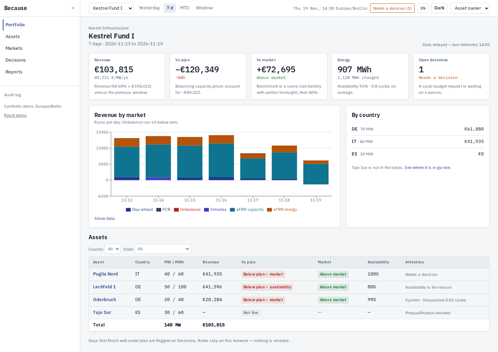
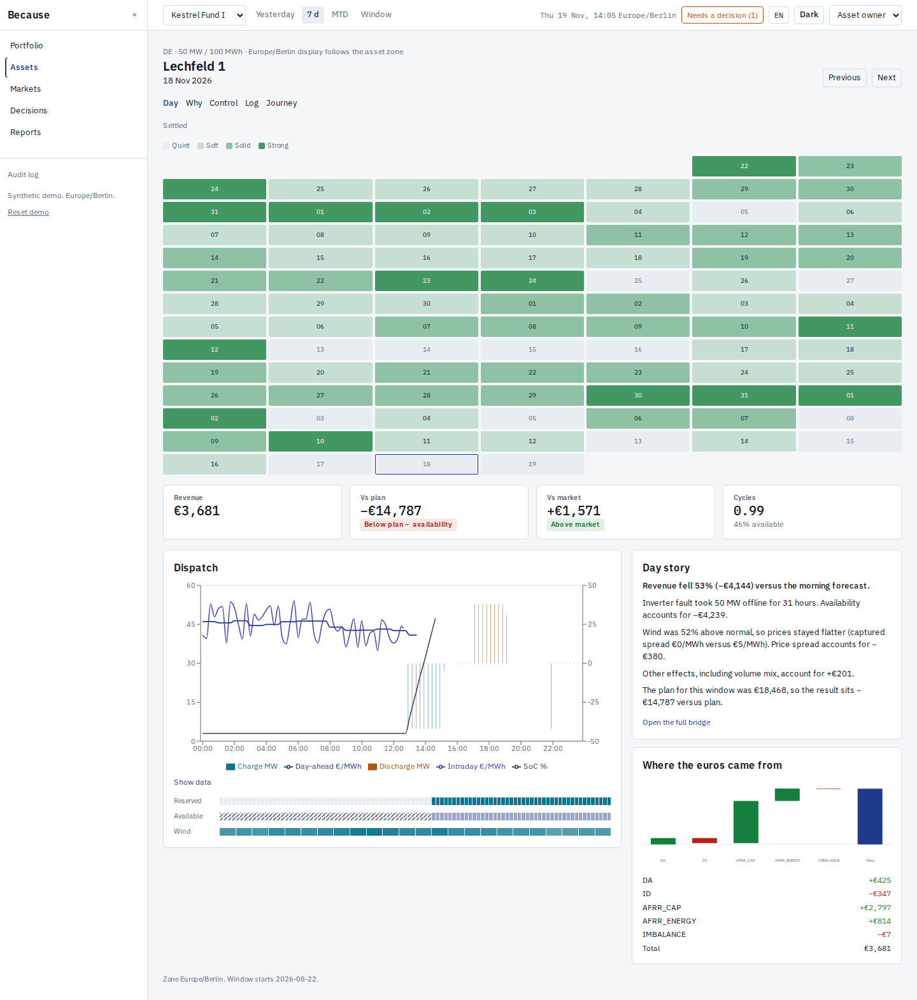
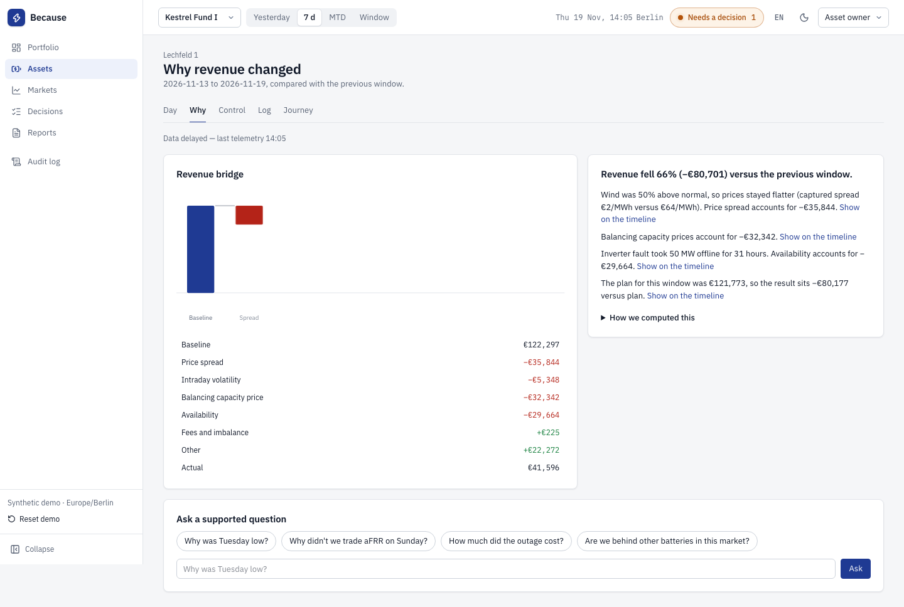
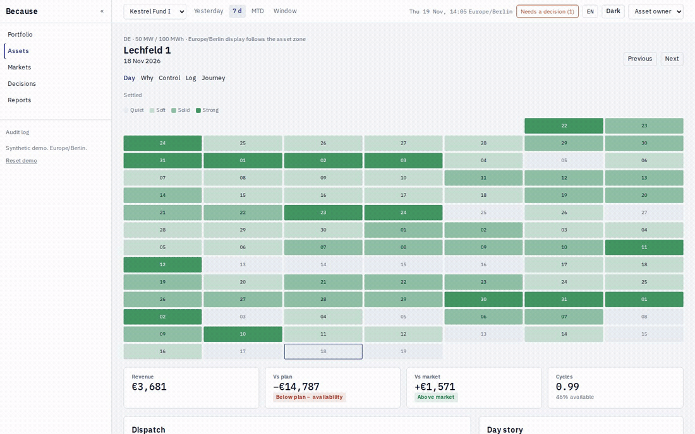
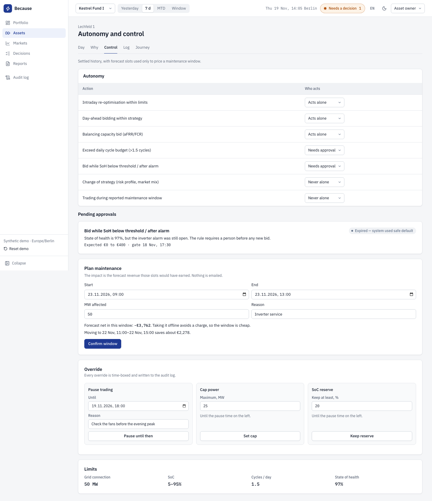
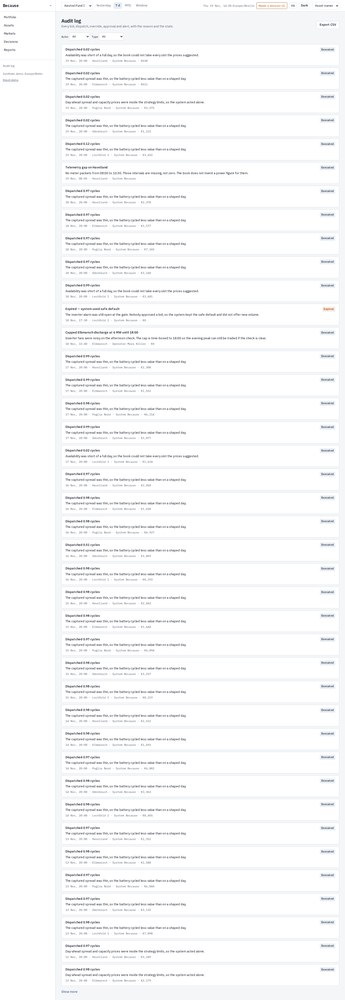
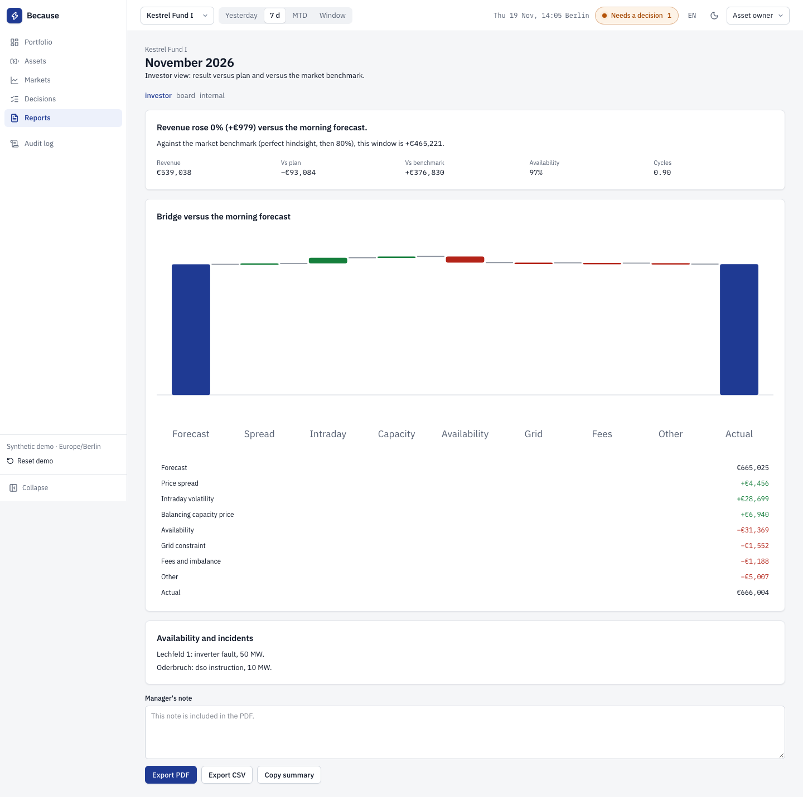
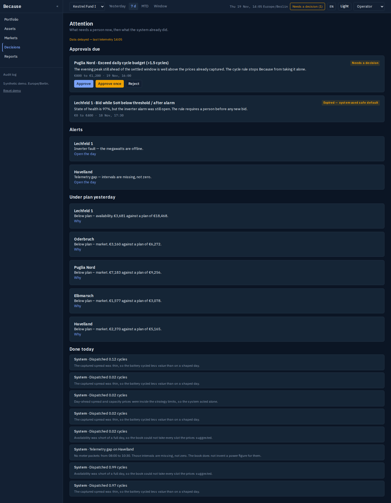
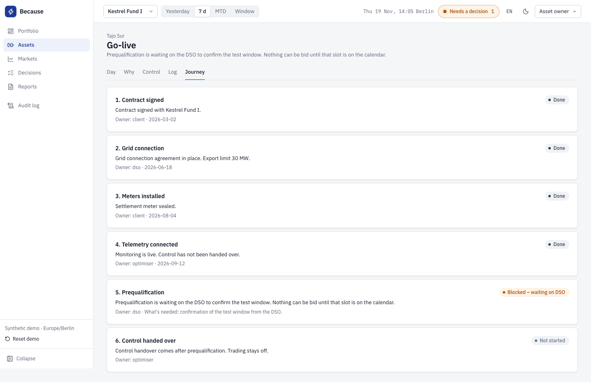

# Because

> See why your battery earned what it earned.



Live demo: [https://battery-because.vercel.app](https://battery-because.vercel.app)

Because is a console for owners and operators of grid-scale batteries in Europe. An algorithm trades the asset across day-ahead, intraday and balancing markets. The screen shows the state and the reason, not a bare number.

Project passport: [docs/PROJECT.md](docs/PROJECT.md).

## The problem

Battery owners hand an asset to an algorithm and get a revenue figure back. A number without a reason scares people. A number with a reason builds trust. *"Yesterday was cloudy and windy, prices were flat, so the battery earned less."*

## Who it's for

- **Fund / infrastructure asset managers.** A portfolio across countries. They need to know if each asset is on plan, why, and how it compares with the market, then report that to an investment committee.
- **Municipal utility portfolio managers.** One to three batteries beside many other duties. They want a short daily status, an explanation for a bad day without a phone call, and a maintenance window without an email chain.
- **Trading and operations staff.** Many assets. They need "what needs me now" and "what the system did alone", and a way to approve or override that leaves a trace.

## What it solves

| Problem | How the prototype answers it | Screen |
|---|---|---|
| "Why did revenue drop last week?" | Revenue bridge and a plain-language explanation whose figures are the bridge | Why |
| "What did the battery actually do yesterday?" | 15-minute dispatch across markets, with state of charge, prices and weather | Asset day |
| "What does the system decide alone?" | Autonomy matrix, an approval queue, time-boxed overrides | Control |
| "Who changed what, and why?" | Audit log with a state and a reason on every entry | Log |
| "I need a board report by Friday" | Investor, board or internal PDF and CSV | Reports |
| "Am I doing well compared with the market?" | Plan, morning forecast and a market benchmark on the KPIs | Portfolio, Why |
| "I need a maintenance window next week" | Self-service window with the revenue given up, and a cheaper slot if one exists | Control |
| "Where is my new battery in go-live?" | Stepper with the owner and the blocker on each step | Journey |

## Competitor landscape

| Provider | What they do | What the client sees | What's still missing |
|---|---|---|---|
| [enspired](https://www.enspired-trading.com/bess) | AI BESS optimisation, DE/NL/AT/PL | 24/7 portal with every trade; independently assured revenue benchmark | Plain-language "why" for a given day; autonomy model |
| [suena energy](https://www.suena.energy/en/vermarktung-stand-alone) | Energy Trading Autopilot, multi-market | Dashboard with decisions, settlements, scenario tests; manual override | Who-decides-what model and audit trail |
| [Statkraft](https://www.statkraft.de/kundenangebot/batterievermarktung/) | Cross-market marketing with a 24/7 desk | Portal with daily transactions, metering, revenues | Interpretation: data, not reasons |
| [QUADRA energy](https://www.quadra-energy.com/qnect/batteriespeicher-optimierung/) | Q.nect platform, open-book or index model | Mobile portal: schedules, billing, unavailability reporting, API | Narrative explanation, investor reports, onboarding journey |
| [terralayr](https://www.trlyr.com/layr/) | Virtual batteries, several optimisers in parallel, tolling | Asset-manager dashboards, one API for offtakers | Trust through diversification, not explanation |

*Benchmarks such as [Modo Energy ME BESS DE](https://modoenergy.com/research/en/me-bess-de-1h-2h-4h-germany-battery-bess-benchmark-live-terminal-virtual-asset-simulation-may-2026) exist, but they live outside the owner's daily view.*

## Screens

**Portfolio.** Period revenue, versus plan, versus a market benchmark, and a one-line reason on each figure.

**Asset day.** Ninety-day revenue calendar, then the 15-minute dispatch. Scrub a quarter-hour and the tooltip states the trade, the price and the driver.



**Why revenue changed.** A bridge from the previous window (or the morning forecast) to the result. Every euro in the sentences is a line in the bridge.



The short recording below is the asset-day timeline, then the same "why did revenue change" path, including the Tuesday question.



**Control.** Acts alone, needs approval, or never alone. Pending items show the expected euros and the gate. A maintenance window prices itself from the forecast.



**Audit log.** System, operator and owner, each entry with a state: executed, approved, rejected, expired, reverted or failed.



**Reports.** Pick a month or a quarter and an audience. Export PDF or CSV, or copy the summary.



**Attention.** The operator view opens on actions: approvals by gate time, alerts, assets under plan, then what the system already did.



**Go-live.** Tajo Sur is stuck at prequalification, waiting on the DSO. The portfolio shows it as not live.



## Design principles

- State and reason, not a raw number. Named states, never a confidence percentage.
- Acts alone, needs approval, or never alone.
- Every action leaves a trace.
- One product, three views of the same asset. The role switcher changes the landing screen and the wording. It does not change the book.

## Design decisions

Light is the default. Owners, municipal utilities and finance teams work in daylight and paste figures into decks. Dark is for operators watching the book: opening Decisions as an operator uses it, and the header toggle keeps either theme.

The type is IBM Plex Sans for the interface and IBM Plex Mono for money, power and time, with tabular figures. Body text is 13px. Cards use a 6px radius, controls 4px. Surfaces are opaque, with a 1px border. There is no blur and no gradient on the chrome.

Navy is the action colour. Amber is attention: a decision waiting, a highlight on money. Charge is cyan and discharge is amber, and both are labelled, so the hues are not the only signal. Price up is green and price down is red, again with a plus or a minus. State of charge is a single slate line.

The shell is a left nav and a 48px top bar: portfolio, period, the demo clock in Europe/Berlin, and a status that says "System running" or "Needs a decision (n)". Charts are Recharts through a thin wrapper, with a "Show data" table under each one. Approvals are an inbox: Approve, Approve once, Reject with a reason. The audit list is a trace of the same events.

## How the data works

All data is synthetic and seeded (seed `20261119`). The window is 90 days ending 19 Nov 2026, at 15-minute resolution, for DE, PL, IT, ES and PT prices. Six invented assets sit in two portfolios: Kestrel Fund I (Lechfeld 1, Oderbruch, Puglia Nord, Tajo Sur) and Stadtwerk Elbe (Elbmarsch, Havelland). Tajo Sur is not trading.

Prices follow weather regimes: a sunny duck curve, a windy stretch, a cloudy-and-windy week with flat spreads, a dark still week, and a volatile day. Dispatch respects state of charge, round-trip efficiency, the cycle cap and availability. Revenue is discharge earnings minus charge cost, plus capacity payments, minus imbalance.

Explanations are rule-based templates in `lib/explain`. The same function returns the bridge and the sentences, so an LLM can replace the templates later without changing the screens. Tests check that the bridge sums to actual minus baseline, and that every number in the sentences was computed from that bridge or from the weather and outages.

Money is stored in euro cents. The header toggles `en-GB` and `de-DE` formatting. Approvals, overrides, maintenance windows and the manager's note are kept in this browser. **Reset demo** restores the seed.

The seeded week of 13–19 Nov 2026 is cloudy and windy, with an inverter fault at Lechfeld 1, so "why did revenue fall?" has a real answer.

## Tech

Next.js 16.4.6 · TypeScript (strict) · Tailwind CSS · shadcn-style components · Recharts · react-pdf · Vitest · Playwright · Vercel

No environment variables. No external market APIs.

## Run locally

```bash
npm i
npm run data
npm run dev
```

`npm run data` writes `lib/mock/data/summary.json`. The app also generates the book in memory from the same seed, so the dev server works after `npm i` alone.

```bash
npm run lint
npm run typecheck
npm run test
npm run build
npm run test:e2e
```

## Roadmap

LLM-backed questions behind the same `explain()` interface, real market data, multi-user roles, and alerts by email.

## License

MIT. Copyright 2026 Denys Sergushkin (sergushkincom).
